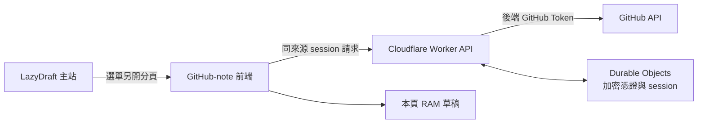

# GitHub-note 功能規格

## 1. 文件狀態

本文件整理已確認的設計訪談共識，供需求審閱與後續實作使用。

**目前狀態為「規格已確認，暫不實作 GitHub-note」。**

本文件不代表授權開發、安裝套件、修改選單、部署服務或建立測試 repository。後續須有明確執行指令，才進入實作與真實 GitHub 驗證。

下文的「須」表示驗收要求，不表示功能已完成。編輯器候選、效能與免費配額是否足夠，仍須用實作證明。

對應訪談 Q24。

## 2. 目標與使用範圍

GitHub-note 是 LazyDraft 的獨立附屬功能。使用者登入 GitHub 後，可瀏覽自己的 repository，開啟檔案、查看與修改內容，再將目前檔案提交至選定分支。

使用範圍如下。

- 僅供本人 GitHub 帳號使用，不提供多人服務。
- 後端須驗證實際授權的 GitHub 使用者身分，不能只信任前端傳來的帳號名稱。
- 只列出本人名下且已授權的公開、私人與 fork repository。
- 不包含只是協作者的 repository，也不包含組織名下的 repository。
- 操作目標是單一檔案，不提供多檔 staging 或整個 repository 的同步。
- GitHub 的實際權限、封存狀態與分支保護仍生效。被拒絕時須顯示原因並保留草稿，不能繞過保護。

本次已允許輕量後端。最初的純前端 PAT 構想不再是本規格採用的登入方案。

對應訪談 Q1、Q5、Q7。

## 3. 部署、授權與憑證

### 3.1 專案位置與獨立來源

未來原始碼放在 LazyDraft 的 `github-note/` 資料夾。這是規劃位置，目前不因本文件而建立功能資料夾。

實際服務採獨立來源，例如專用子網域或 `workers.dev` 站點。網址不要求是 LazyDraft 原站的 `/github-note/`。

GitHub-note 前端與自己的 API 保持同來源，但與既有 LazyDraft 子頁隔離。如此不依賴第三方 Cookie，也不讓其他同來源頁面直接共享可操作 GitHub 的登入環境。

### 3.2 Cloudflare 免費方案

部署方案為 Cloudflare Workers Free。Durable Objects 保存加密的 session 憑證資料與 refresh token，不保存編輯草稿或私人檔案內容。

免費方案不等於已證明能滿足本規格。記憶體、CPU、請求大小與儲存配額都須按實際方案驗證，尤其是大檔的讀取與 Push。

若免費方案不能通過容量驗收，須回報測量結果並重新決策。不得自行降低容量上限、截斷內容或啟用付費方案。

### 3.3 私人 GitHub App

認證採私人 GitHub App，只授權必要的 repository 內容讀寫與 metadata 存取，並限定使用者選定的 repository。

不以廣泛的 OAuth App `repo` scope 作為預設，也不把開發機 GitHub CLI 的權杖拿來當網頁應用的憑證。

client secret、加密金鑰及 GitHub Token 只留在後端。不得放入前端程式、公開設定檔、URL 或日誌，也不得要求使用者貼到聊天。

### 3.4 30 天登入生命週期

- 應用 session 最長保留 30 天。
- 瀏覽器只持有 HttpOnly session Cookie，不把 GitHub Token 寫入 `localStorage` 或 IndexedDB。
- 後端負責必要的 Token 換發。應用 session 保留時間不等於 GitHub access token 的有效期。
- 主動登出須使該 session 失效。
- 關閉瀏覽器不視為可靠的登出保證。
- 授權過期、撤銷或換發失敗時，須要求重新登入，不得順便刪除仍在頁面中的草稿。
- 重新登入流程不得在未確認的情況下丟棄 RAM 草稿。

以下是規劃中的資料關係，不是已部署架構。

對應訪談 Q12、Q13、Q20。

## 4. 導覽與裝置介面

- LazyDraft 左上角 dropdown 增加 GitHub-note 入口。
- 入口另開獨立服務，不取代主編輯器，也不清空 LazyDraft 原有草稿。
- 外圍介面參照現有子功能的導覽與深淺主題風格，不因此帶入它們的自動儲存機制。
- 桌面須能完成瀏覽、編輯、切換模式、比較差異及 Push。
- 手機與平板只瀏覽，不提供修改與 Push 操作。
- 檔案載入後，依副檔名自動選擇對應設定。

對應訪談 Q6，以及原始需求的選單位置要求。

## 5. 檔案模式與容量

容量按原始檔案 bytes 計算，不按 Base64 膨脹後的傳輸量計算。1 MiB 為 1,048,576 bytes。Notebook 的 JSON、metadata、附件及輸出都計入檔案大小。

| 檔案類型 | 必須提供的介面 | 原始檔案上限 |
| --- | --- | ---: |
| Markdown `.md` | 原始碼與富文本兩種編輯模式，另有預覽。詳細規則見第 6 節。 | 10 MiB |
| 純文字 | 純文字編輯，不轉換成 HTML 或富文本文件。 | 10 MiB |
| PHP、Python、Bash、JavaScript、TypeScript、CSS | 原始碼編輯與對應語言的語法高亮。 | 10 MiB |
| HTML | 原始碼編輯，包含內嵌 CSS 與 JavaScript 的語法高亮。 | 10 MiB |
| `.ipynb` | Notebook cell 顯示與編輯。詳細規則見第 7 節。 | 50 MiB |

這些是產品驗收目標，不是已量測達標的結果。

超過上限時，只顯示檔案資訊與 GitHub 連結，不載入編輯器。不得截斷檔案，也不得只提交能處理的片段。修改後超限時須阻止 Push，保留目前草稿供使用者處理。

對應訪談 Q18，以及原始需求的五種檔案介面。

## 6. Markdown 編輯與預覽

### 6.1 兩種編輯模式

`.md` 同時提供原始碼與富文本編輯，不能只做原始碼加唯讀預覽，就宣稱完成雙模式要求。

Markdown 檔案是提交內容，不以編輯器內部 HTML、Delta、EditorState 或區塊 JSON 取代原文。

模式切換不得悄悄刪除資料。富文本無法安全表示的語法須保留為受保護原始碼區塊，使用者切到原始碼模式修改該部分。其他支援的段落仍可做富文本編輯。

特殊 HTML、註解或尚未支援的擴充語法，不能在匯入或序列化時消失。

### 6.2 GitHub 相容範圍

預覽須支援完整 GFM，並納入以下 GitHub 平台擴充與資源處理。

- 公式。
- Mermaid。
- 提示框，例如 `[!NOTE]` 與 `[!WARNING]`。
- 註腳。
- 目前 repository 與分支中的相對連結、圖片與頁面內錨點。

GFM 的表格、task list、程式碼區塊與其他標準語法都須納入樣本。只顯示粗體與清單不算完整相容。

富文本中的受保護區塊與預覽是不同用途。某項語法無法直接做富文本編輯，不代表預覽可以忽略該語法的顯示要求。

### 6.3 本機預覽與官方校對

平常提供本機即時預覽。只有使用者按下「GitHub 預覽校對」時，才把未提交草稿送交 GitHub Markdown API。

不得隨每次輸入自動傳送草稿，也不能把預覽請求當作 Push。

本機預覽不承諾每次都與 GitHub 平台處理完全一致。官方 API 回傳的是 HTML，不是整套 GitHub 頁面、樣式與互動元件，仍須驗證本地呈現。

### 6.4 圖片與外部資源

安全的 HTTPS 外部圖片與媒體採自動載入，不採預設點擊後才連線的方案。使用者已接受外站可能觀察到資源請求。

repository 內的相對圖片透過授權的 GitHub 讀取流程取得。GitHub Token 不得放入圖片 URL，也不得轉送外站。

允許載入資源不表示允許執行檔案內的 JavaScript、事件處理器或 Notebook widgets。HTML 原始碼模式不執行該檔案。

對應訪談 Q3、Q8、Q10、Q16、Q23。

## 7. Notebook 顯示與編輯

### 7.1 Colab-like 的範圍

目標為 `nbformat` v4 Notebook 的 cell 顯示與編輯，不是建立 Colab 運算環境。

不提供 Run cells、Kernel、Python 執行、GPU、Google Drive 掛載或互動 widgets 執行。

### 7.2 Cell 操作

基本操作包含以下項目。

- 修改 Code 與 Markdown cell 的來源內容。
- 插入與刪除 cell。
- 上下移動 cell。
- 切換 Code 與 Markdown cell 類型。

刪除或轉換可能移除輸出的 cell 時，須提示相關資料會被移除。既有 raw cells 須保留，不能因編輯器沒有對應工具而丟掉。

### 7.3 輸出與 metadata

只顯示安全的靜態輸出，例如文字、圖片、表格、公式與經安全清理的 HTML。

不能安全顯示的輸出須保留原始資料，並呈現類型提示。不得因無法執行 JavaScript 或 widgets 而刪掉對應 MIME 資料。

修改程式碼不代表重新執行。不得偽造新的 `execution_count`，也不能把原本輸出宣稱為本工具執行目前程式碼的結果。

未被明確操作的資料須保留，包括 notebook 與 cell 的 metadata、Colab 自訂資料、cell ID、outputs、附件與其他未知欄位。

Notebook 來源與輸出欄位可能是字串，也可能是字串陣列。讀寫不能假設只有其中一種，更不能把 Notebook 轉成一般富文本區塊後遺失其結構。

對應訪談 Q2、Q9、Q15。

## 8. RAM 草稿與救援

**登入保留 30 天，不代表草稿保留 30 天。**

草稿只放在目前頁面的記憶體。不使用 IndexedDB、`localStorage`、Service Worker 快取或其他持久機制保存私人檔案副本。後端也不保存草稿內容。

重新載入、關閉頁面、瀏覽器崩潰或強制結束，都可能失去尚未 Push 的修改。這個風險已在訪談中確認，不得暗中改回自動本機存檔。

未提交修改的處理規則如下。

- 切換檔案、repository、分支或主動登出前，須提示尚未 Push 的修改。
- 不得為了離開頁面而自動 Push，也不得未經確認直接丟棄內容。
- 瀏覽器重載或關頁時可使用原生離開警告，但不保證能攔住崩潰或強制關閉。
- 提供手動「下載目前修改副本」。只有使用者主動操作才下載，不自動寫入硬碟。
- 下載內容須是完整檔案，不是單一 cell、畫面片段或編輯器內部快照。
- 斷網、權限不足、登入失效或 Push 失敗時，仍保留頁面中現有草稿。

對應訪談 Q14、Q19。

## 9. 單檔提交與非同步衝突

### 9.1 手動單檔 commit

使用者明確選擇 repository、branch 與 path，再手動 Push。目前修改只產生該檔案的 commit，不一併提交其他檔案。

提交前須顯示目標分支、檔案與差異，並提供 commit message。不得背景自動同步、自動建立 PR 或自動改用其他分支。

編輯狀態須綁定帳號、repository、分支、路徑與載入時的檔案 blob SHA，避免非同步結果更新錯誤的檔案。

Push 使用確認時的內容快照。等待回應期間新增的修改不能因舊回應成功而被清掉或誤標為已提交。連點 Push 也不能造成未受控的重複提交。

### 9.2 SHA 不一致與 409 Conflict

遠端已修改時，採以下策略。

1. 停止提交，保留本地修改與原始比較基準。
2. 取得最新遠端版本並呈現差異。
3. 使用者人工處理後，重新確認差異與提交。

不提供直接用最新 SHA 覆蓋遠端的捷徑，不自動 force-push，也不以自動建立 PR 取代這個流程。

權限拒絕、分支保護、API 配額或網路問題也不能導致草稿消失。無法確定提交結果時，須標明狀態，不能假裝成功。

對應訪談 Q4、Q11。

## 10. 編碼與 GitHub API 邊界

### 10.1 UTF-8 無損編解碼

只允許可無損解碼的 UTF-8 文字進入編輯器。BOM 與既有換行不得在編解碼或模式切換時被悄悄改寫。

不自動猜測或轉換 Big5、GBK 等編碼。二進位、非一般檔案或無法可靠解碼的內容須明確標示不能編輯，不以亂碼或替代字元載入後允許 Push。

UTF-8 與 Base64 是不同處理層。須使用 `TextEncoder`、`TextDecoder` 與正確的 byte 層 Base64 處理。不得直接對包含繁體中文或 Emoji 的 Unicode 字串呼叫 `atob` 或 `btoa`。

### 10.2 Contents API 的讀取規則

GitHub 文件對 Contents 讀取端點的規則如下。此處沿用官方的 MB 單位，不把它當作本規格的 MiB 容量定義。

| GitHub 文件所列檔案大小 | Contents 讀取行為 |
| --- | --- |
| 1 MB 以下，含邊界 | 支援一般內容回應。檔案內容可由 Base64 欄位取得。 |
| 大於 1 MB，且不超過 100 MB | 須使用支援的 raw 或 object media type。object 回應的 `content` 會是空字串，`encoding` 為 `none`。實際內容由 raw 取得。 |
| 大於 100 MB | 此讀取端點不支援。 |

因此，超過 1 MB 不代表一定要改走 Git Blobs API，也不代表檔案只能唯讀。

目錄的 Contents 回應有 1,000 個項目的上限。不能把截斷清單當作完整目錄，較大目錄須採可完整取得結果的 Git Trees 等方式。

### 10.3 寫入與傳輸

更新檔案需提供 commit message、Base64 內容、目標分支與被取代檔案的 blob SHA。blob SHA 不是分支 commit SHA。

讀取端點的上限不是已驗證的 Push 上限。Base64、JSON、後端請求限制與記憶體使用都須納入實測。

若採 Git Blobs API，建立 blob 本身不會完成分支提交，仍須處理 tree、commit 與 ref。實際 API 路徑由架構與驗證結果決定，不預先添加多套寫入途徑。

對應訪談 Q21，以及前次 API 邊界調查。

## 11. 編輯器調查與比較規則

### 11.1 現有 editor-lab 的能力邊界

前次掃描確認現有六款為 Squire、Trix、Tiptap、Lexical、Editor.js 與 Trumbowyg。

它們目前的整合以 HTML、富文本文件樹或區塊 JSON 為主。沒有任何一款現成整合同時滿足本規格的所有檔案模式。

程式碼區塊不等於完整原始碼編輯器。Editor.js 區塊 JSON 也不等於 Notebook 格式。不能拿一般 HTML 匯出或框架快照直接覆蓋 repository 原檔。

可參考目前的 [編輯器目錄](editor-lab/src/catalogue.ts)、[共通整合介面](editor-lab/src/contracts.ts)與 [Markdown Editor](markdown-editor/js/app.js)。這些是既有實作參考，不是新功能已完成的證據。

### 11.2 候選組合仍待實作

Tiptap 與 Lexical 是 Markdown 富文本候選，不是已合格的最終選擇。

候選需要搭配專用原始碼編輯核心與 Notebook 資料層。CodeMirror 6 可作原始碼核心的優先驗證提案，但套件、版本與具體組合尚未定案。

不能因既有 `markdown-editor/` 使用 CodeMirror，就宣稱它已具備所有語言、混合 HTML 高亮與 Notebook 能力。

### 11.3 先合格，再比較，再擇一

所有候選使用相同功能、無損性、容量與安全驗收條件。

- 若兩套以上通過，提供可操作的 A/B 實作與同一批樣本結果，供使用者比較。
- 比較包含實際編輯、模式切換、Git 差異、載入開銷與大檔表現，不只比較函式庫介紹。
- 若只有一套通過，須列出另一套的失敗證據，不為湊數下修要求。
- 使用者比較後選定一套，正式功能不永久維護多套編輯器。

對應訪談 Q22，以及原始需求的實作比較要求。

## 12. 驗收條件與證據

本節是未來的驗收要求。目前尚無 GitHub-note 功能驗證結果。

| 驗收場景 | 通過條件與所需證據 |
| --- | --- |
| 本人與 repository 限制 | 後端拒絕未授權身分。只呈現允許的個人 repository，不只靠前端隱藏操作。 |
| 登入生命週期 | GitHub Token 不進前端持久儲存，前端只保留 HttpOnly session Cookie。換發、到期、撤銷與登出不造成草稿被誤刪。 |
| 檔案介面 | 實際開啟五類檔案，觀察對應介面與可編輯行為。HTML 同時檢查 CSS 與 JavaScript 區段。 |
| Unicode 與換行 | 中文、Emoji、BOM、LF 與 CRLF 樣本經讀取、修改、下載及提交後沒有非預期改寫。 |
| Markdown 往返 | 標準與擴充樣本可預覽，受保護語法不消失。比較模式切換與實際修改後的 Git 差異。 |
| Notebook 保留 | cell 操作正確。未知 metadata、既有 outputs、附件與 raw cells 不因讀寫而遺失。 |
| 單檔 Push | 真實 GitHub commit 只包含明確選定的檔案與分支，取得可核對的提交證據。 |
| 遠端衝突 | 以兩份不同載入基準製造衝突，確認保留本地內容、顯示遠端差異，且沒有覆寫捷徑。 |
| Push 期間繼續編輯 | 回應不能清除或誤標新增修改。重複操作不造成未受控的多次提交。 |
| RAM-only 與救援 | 無私人草稿持久副本。離開警告、失敗後保留與完整檔案手動下載都須實際操作。 |
| 容量邊界 | 使用第 5 節上限內、恰好到達上限與超限的樣本。驗證讀取、編輯及提交，不只檢查檔案大小。 |
| 裝置與導覽 | 桌面完成操作，手機和平板唯讀。主站選單另開服務並保留主站草稿。 |
| 免費方案 | 在實際部署環境驗證大檔與憑證流程。本機成功不能取代 Cloudflare 配額下的證據。 |

真實驗證限定專用測試 repository 與測試分支，不修改正式 repository 內容或正式預設分支。建立新測試 repository 時允許必要初始化。

測試可建立檔案與 commit，以驗證登入、讀取、修改、Unicode、Notebook 與衝突。不得自動刪除測試 repository。

本機模擬 API 與單元測試只能提供部分證據，不能代替真實 GitHub 登入及 Push。所有既有測試也不得退步。

對應訪談 Q17。上述遠端測試方式須等後續明確執行指令後才啟動。

## 13. 執行前提與尚待決定事項

以下是後續實作的必要前提，不是已完成的設定。

- 私人 GitHub App 註冊、必要權限及 repository 授權。
- 本人 GitHub 使用者身分的後端限制設定。
- Cloudflare 帳號授權、獨立服務網址與正確 callback 設定。
- 後端秘密、加密金鑰與憑證撤銷機制。
- 專用測試 repository 及測試分支。

以下項目仍待架構設計或實測，不在本文件中假裝定案。

- 最終編輯器與套件版本。
- 原始碼核心與 Notebook 轉接層的具體實作。
- GitHub API 路徑、大目錄瀏覽及大檔傳輸的實作方式。
- session 換發同步、撤銷與加密金鑰管理細節。
- A/B 實作的效能結果與正式版本的選擇。
- 免費方案能否通過已確認容量目標。

尚未約定固定毫秒數的效能門檻，不能把其他 LazyDraft 功能的效能目標直接套用到 GitHub-note。操作反應、記憶體與載入開銷須以實測結果呈現。

瀏覽器使用的 JavaScript 資源須有正確 MIME type。專案先前曾遇到 `.mjs` 被主機回傳為 `application/octet-stream` 的問題，後續瀏覽器建置產物應沿用 `.js`，並實際驗證模組載入。

## 14. 參考資料

以下文件提供 API 與格式限制。服務配額與 API 行為可能調整，實作時仍須核對。

- [GitHub App 代表使用者操作的認證方式](https://docs.github.com/en/apps/creating-github-apps/authenticating-with-a-github-app/authenticating-with-a-github-app-on-behalf-of-a-user)
- [GitHub OAuth App 授權與 GitHub App 選型說明](https://docs.github.com/en/apps/oauth-apps/building-oauth-apps/authorizing-oauth-apps)
- [GitHub repository Contents API](https://docs.github.com/en/rest/repos/contents)
- [GitHub Git Blobs API](https://docs.github.com/en/rest/git/blobs)
- [GitHub Markdown API](https://docs.github.com/en/rest/markdown/markdown)
- [Jupyter Notebook 格式](https://nbformat.readthedocs.io/en/latest/format_description.html)
- [Cloudflare Workers 配額](https://developers.cloudflare.com/workers/platform/limits/)
- [Cloudflare Workers 費用](https://developers.cloudflare.com/workers/platform/pricing/)
- [Cloudflare Durable Objects 配額](https://developers.cloudflare.com/durable-objects/platform/limits/)
