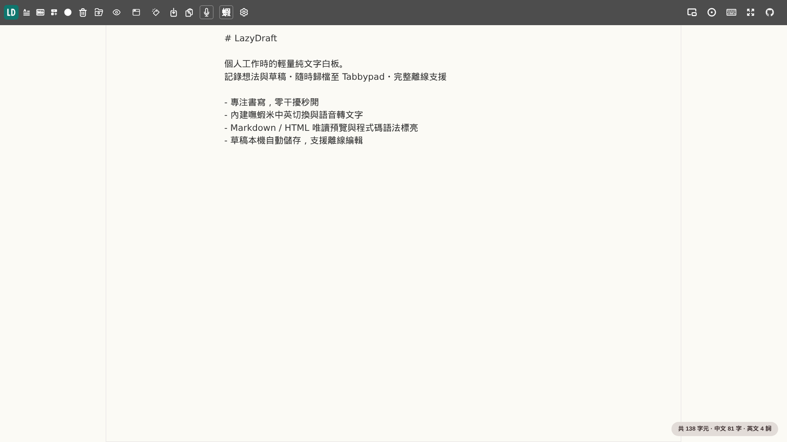

# LazyDraft

A lightweight plain-text whiteboard for notes, drafts, and AI prompts, with local autosave, Tabbypad archiving, and offline PWA support.

> [繁體中文](README.md) · [English](README_EN.md) · [简体中文](README_ZH_CN.md)



Forked from [amitmerchant1990/notepad](https://github.com/amitmerchant1990/notepad). Daily workflow: **draft → create/update a Tabbypad item → automatically clear and start the next draft**.

## Editor & Tools

- **Autosave**: Drafts persist in browser `localStorage`; Tabbypad uses IndexedDB. Clearing site data removes local content; download separate backups of important notes.
- **Download and copy**: Copy the entire note or download `.txt`. The filename uses the first line, falling back to `Notes-DD-MM-YYYY.txt` when that line is blank.
- **Appearance**: Light, dark, or system theme; fonts, size, line height, paper textures, optimal line width, spellcheck, and Tab indentation.
- **Count summary**: Optional bottom-right totals for characters, Chinese characters, and English words. Characters count Unicode code points, including whitespace; Chinese counts individual Han characters, English counts letter-based words. Compound emoji may count as more than one character.
- **Floating window**: Requires desktop Document Picture-in-Picture support; close or return through native frame controls. Focus and fullscreen modes are also available.
- **Utilities**: Open Rich Text Notes, Markdown Editor, Tabbypad, and AI-RegExr from the toolbar without replacing the draft.
- **Text QR**: The toolbar opens a display-only text QR snapshot; prefers selected text, falling back to the full draft. The limit is **2,048 UTF-8 bytes** (inclusive), preserving whitespace, newlines, Chinese, and emoji; empty or oversized text is refused without truncation or multi-code splitting. The QR code displays plain text without download/export buttons or receive acknowledgements; closing clears the preview, snapshot, and code without saving history, modifying drafts, or altering Tabbypad.
- **Scanning & offline**: Scan with an external camera/scanner and manually copy/paste; no synchronization or automatic draft clearing. Dense codes may not scan or expose full text on every camera. Generation works offline after initial online precaching; the encoder executes only on first opening QR, without CDNs, servers, or WebRTC.

### Boshiamy & Dictation

- Click **蝦** or press `Ctrl/Cmd+B` to toggle Boshiamy. Letter radicals are lowercase only; `, . ' [ ]` remain radicals. Uppercase passes through, cancelling pending code without changing mode. Codes have up to 4 characters. Space/Enter commits the page's first candidate; `0–9` selects candidates (0 is first); Up/Down or PageUp/PageDown changes pages; Backspace corrects and Esc cancels.
- Invalid codes or selections retain composition with a notice. Pending radicals never enter the document or autosave. With pending code, the first `Ctrl/Cmd+Z` only cancels composition; other undo/redo grouping is browser-defined, not necessarily one step per candidate.
- Dictionary data is read only on activation; startup prepares a connection to the separate `lazydraft-ime-cache` IndexedDB database. Flat code/candidate text, offsets, and maximum code length are cached under the full versioned URL without changing drafts or Tabbypad data. Warm loads look up candidates without parsing the full JSON; misses or unavailable storage rebuild from the JSON file. Failed loads can be retried; first activation works offline after the main cache is installed. Acceptance covers **desktop Chrome/Edge with physical keyboards**, not mobile or other browsers.
- Each activation starts in Chinese; language mode is not saved. With the textarea focused, a pure `Ctrl+Alt` chord (macOS `Control+Option`) toggles once on the first release. A third key, AltGr, or focus loss cancels the chord. English mode cancels pending code and uses native input. Mode notices also work in floating windows. System shortcuts such as VoiceOver may intercept the chord.
- Chinese mode suspends native spellcheck and autocorrect, including loading and saved activation on startup; Spellcheck is off and locked with an explanation. English mode restores the editable spelling preference, sets an English language hint and `autocorrect=on`. Disabling, cancellation, or loading failure restores original settings. Mode changes do not rewrite spelling preferences; actual assistance depends on the browser/OS. Reset restores defaults.
- The microphone or `Ctrl/Cmd+M` toggles Web Speech API dictation at the cursor. Language follows the browser or Preferences. Availability depends on the browser and speech service; offline operation is not guaranteed.
- Page load only constructs a recognition object, without starting recording or requesting permission. Missing APIs or construction failures hide the microphone, language setting, and speech shortcut help, leaving `Ctrl/Cmd+M` native. Successful construction does not guarantee service availability; permission/service errors during use show a notice and keep the entry available for retry.

### Tabbypad

- **Tabbypad**: Load existing items to edit or save a new item. Successful creation or manual **更新原項目 (Update Original)**, including the bottom-right button, clears and unlinks an unchanged draft, closes the manager, and focuses the plain-text editor. Reloading keeps it blank.
- **Save protection**: Failed/cancelled saves, unresolved conflicts, or draft/link changes while waiting never clear current content. If Tabbypad commits but persisting the empty local draft fails, a “saved, but not cleared” notice preserves the content and link for recovery.
- **Backup and load**: Loading another item offers backup or discard; a successful backup proceeds to the target rather than an empty editor, while failure retains the draft. Updates still detect other-tab changes/deletions. Unarchived local drafts survive reopening, but their item link is removed.

## Preview & Highlighting

**MD (eye) / HTML (window)** toggles read-only preview; click again or use **返回純文字 (Return to Plain Text)** to edit. Plain text and both previews are mutually exclusive. Toggling preserves source, cursor, and scroll; reopening starts in plain text. Downloads, copy, archiving, and Push always use the source.

- **Markdown**: Standard Markdown/GFM, tables, code, and read-only task lists; no math, Mermaid, or preview code highlighting. Embedded HTML is literal text; generated HTML is sanitized. External HTTP(S) links open in isolated tabs; dangerous schemes are not clickable.
- **HTML**: Sandboxed HTML+CSS with scripts, event handlers, forms, popups, and navigation blocked. Links cannot navigate; original HTML styling is retained rather than forced dark. Only absolute HTTPS images, stylesheets, and fonts are allowed.
- **Remote resources**: Markdown automatically loads only absolute HTTPS images. Remote resources in either preview may reveal IP/request time and may be unavailable offline. Relative and non-HTTPS resources do not load.
- **Syntax (wand)**: Eight choices: HTML, PHP, JavaScript, TypeScript, Python, JSON, Bash, YAML. HTML includes embedded CSS/JS and standalone CSS. Highlighting changes color, not source or native editing. The limit is **1 MiB**; larger content stays plain text without truncation.
- Recognized local files select their language without enabling Syntax. Language is remembered, but Syntax starts off on reopening. Preview/highlighting dependencies are included in the main offline cache.

## Opening Local Files

The folder button reads one file as literal text, never executing code. Maximum **1 MiB (1,048,576 bytes)** per file, valid **UTF-8** only. UTF-8 BOM is accepted and removed; line endings become LF.

- Supported formats include text, Markdown, HTML/CSS, common source code, JSON/CSV/logs, YAML/INI, and shell scripts; also `.env`, `.env.*`, `.gitignore`, `.editorconfig`, `Dockerfile`, and `Makefile`. Only supported names are accepted, case-insensitively—not arbitrary extensions.
- The picker has no extension filter, but selected files are still validated. Enable hidden-file visibility to select dotfiles if needed.
- A different draft, including when importing an empty file, offers **overwrite, append, backup to Tabbypad then load, or cancel**. Append retains the linked item without updating its card; overwrite/backup-then-load unlinks it.
- Backup and local persistence must succeed before replacement. Invalid format/encoding, oversized files, quota failures, or draft/link changes during confirmation preserve the current draft. Completed backups remain available.
- Import works offline after the main cache installs. Imported text becomes a local draft; avoid manually Pushing files containing credentials.

## AI-RegExr

Open [AI-RegExr](ai-regexr/) to test JavaScript RegExp or **PCRE2 10.49 (WASM)**. Local files must contain valid UTF-8, with no extension restriction and a **10 MiB** limit; replacing existing text requires confirmation. Test text and patterns are neither persisted nor uploaded. PCRE2 is not PHP `preg_*`.

- Matching runs in a Worker with a **3-second** deadline; background-tab timers may delay termination. Timeouts discard partial results; the next run can retry. Engine loading has a separate 15-second deadline. At most the first **10,000** matches are highlighted.
- The paper plane sends full matches, not capture groups, separated by newlines to one same-origin main page. More than 10,000 requires confirmation and sends only the first 10,000; joined text over **1 MiB** is rejected. PCRE2 byte boundaries inside characters are expanded to whole characters for display/export.
- Existing main-page drafts offer overwrite, append, or backup. Cancellation, backup/storage failure, or draft changes during confirmation prevent replacement. Without an open main page, confirmation opens one and copies matches for manual pasting. Imported text then persists as a main-page draft.
- **Separate offline cache**: Visit the tool and wait for **離線可用 (Offline ready)** before disconnecting; installing the main notepad does not preload it. Updates are SHA-256 verified, retain the old version on failure, and do not force takeover of active tabs.

## Shortcuts

| Action | Windows / Linux | macOS |
| :--- | :--- | :--- |
| Download `.txt` | Ctrl+S | Cmd+S |
| Boshiamy IME | Ctrl+B | Cmd+B |
| Dictation | Ctrl+M | Cmd+M |
| Copy all | Alt+C | Option+C |
| Preferences | Ctrl+, | Cmd+, |
| Shortcut list | Ctrl+K | Cmd+K |
| Focus mode | Alt+F | Option+F |
| Clear note | Ctrl+Shift+Del | Cmd+Shift+Backspace |

## Local Setup & Development

The main app and AI-RegExr require no build. Run from the repository root, then open `http://localhost:8000`:

```sh
python3 -m http.server 8000
```

Developer tools require Node.js; ordinary static deployment does not:

```sh
npm ci --ignore-scripts
npm test                        # Unit tests
npm run typecheck               # Strict DOM/Worker checks
npx playwright install chrome msedge
npm run test:ime:browser         # Actual Chrome/Edge IME/QR acceptance
npm run bench:ime                # 20 warm-cache reloads; every activation must be <50ms
npm run vendor                  # Verify PCRE2 artifacts/source hashes
npm run release                 # Rebuild AI-RegExr manifest/Service Worker
```

Browser tests accept `-- --project=chrome` or `-- --project=msedge`, and `IME_CHROME_PATH` / `IME_EDGE_PATH` for custom binaries. Missing browsers fail the run.

The benchmark uses isolated headless desktop Chrome: one cold activation warms IndexedDB, then 20 page reloads. Service Workers and JSON fallback are blocked; every sample must hit IDB and finish below 50ms or the command fails, without averaging or discarding outliers. Page-side timing starts at the real toolbar click, dispatches `a` through the production controller, and ends when candidate `對` has visible DOM/layout; CDP waits and the next compositor frame are excluded. The threshold is a local warm-cache acceptance check, not a cold-load or all-device guarantee.

Rebuild PCRE2 only for native-interface changes or engine upgrades. Requires Git, CMake, and Emscripten **6.0.13** (`emcc` may be on PATH):

```sh
EMSDK=/path/to/emsdk npm run vendor -- --build
npm run vendor
npm run release
```

## Deployment & Maintenance

- Deploy the complete static directory over HTTP/HTTPS; PHP/Redis are not required. Offline support requires HTTPS or localhost and a completed initial cache. Upgrades must also delete obsolete files, including the retired cloud-sync backend, rather than only overlay new files. With Nginx/Tengine HTTP/2, keep `keepalive_timeout 60s;`, never `0`.
- Root `sw.js` uses cache `v90`; synchronize changed asset URLs and cache entries. Deploy all of `js/ime/v89/` without mixing module versions. AI-RegExr has its own Service Worker, bypassed by the root worker. Run `npm run release` after tool asset changes, then reload old pages.
- PCRE2 source pins and hashes are in `vendor-manifest.json`; see [PCRE2 LICENCE](ai-regexr/vendor/pcre2/LICENCE.md). Rebuild through tooling rather than hand-editing generated glue.
- Icon source: `img/lazydraft-icon.svg`. With developer tools and Chrome installed, run `node scripts/build-icons.mjs`; shared icon changes also require `npm run release`.
- Preserve the existing PWA identity, storage keys, and database names. Installation entry points and prompts are browser-managed; the page has no custom install button. Updates do not require uninstalling or clearing site data; shortcut name/icon refresh is browser/OS-managed.

## License

- [MIT License](LICENSE.txt)
- QR Code generation uses [Nayuki QR Code generator v1.8.0](https://github.com/nayuki/QR-Code-generator/releases/tag/v1.8.0) ([MIT License](js/libraries/qrcodegen-1.8.0.LICENSE)).
